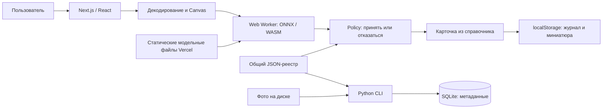

# Архитектура

## Две независимые части

1. **Frontend** — Next.js/React, статический справочник, браузерное распознавание, локальный журнал. Развёрнут на Vercel.
2. **PlantDB** — Python CLI, SQLAlchemy, SQLite для загрузки и регистрации изображений. Запускается отдельно; сайт не обращается к этой БД.

Общий реестр модели — [config/model_labels.json](../config/model_labels.json). Он связывает индекс ответа, исходное название PlantVillage, культуру, состояние и разрешение анализа. Дополнительные карточки — [config/model_conditions.json](../config/model_conditions.json). Эти файлы читают frontend и Python-пакет.

Связь JSON-реестра с обеими частями не является синхронизацией SQL-базы и веб-приложения. Новая строка в SQLite не создаёт новую карточку на сайте и не обучает модель.

## Путь фотографии

1. `Scanner` получает `Blob` из file input или готового тестового образца. Название образца не передаётся модели как подсказка.
2. `validateImage` проверяет тип/объём, декодирует снимок с учётом ориентации и ограничивает число пикселей.
3. `preprocessImage` формирует RGB-тензор: короткая сторона 256, центральный фрагмент 224×224, ImageNet normalization, NCHW float32.
4. `client.ts` передаёт тензор через transferable buffer в `public/diagnosis.worker.js`.
5. Worker лениво создаёт ONNX-сессию, запускает WASM и возвращает 38 logits, 768 признаков и время inference.
6. `policy.ts` проверяет численные данные, считает глобальный softmax и сходство с центроидами, выбирает `accepted` либо `uncertain`.
7. Для принятого состояния `page.tsx` открывает соответствующую карточку. Растение берётся из класса-победителя.
8. Если удалось подготовить миниатюру, запись автоматически сохраняется в журнал. При ошибке миниатюры или хранилища результат остаётся доступным на экране с сообщением.

Фото пользователя не передаётся внешнему AI API. Сетевые запросы при анализе нужны для загрузки статических ресурсов. Полный preview использует временный `blob:` URL, который освобождается при закрытии результата.

## Жизненный цикл Worker

- Одна активная задача на клиент; повторный параллельный запрос возвращает ошибку.
- Сессия повторно используется для следующих фотографий в открытой странице.
- `requestId` отделяет актуальный ответ от запоздавших сообщений.
- `AbortSignal` отменяет задачу; Worker завершается, следующий анализ может создать новый.
- Таймаут стадии работы с Worker — 120 секунд, включая загрузку/инициализацию и inference; асинхронное декодирование до этого этапа в данный таймер не входит.
- При ошибке загрузки/исполнения Worker освобождается для повторной попытки.

## Загрузка и кэш

Модельные файлы лежат под путём с ревизией. Worker сверяет ревизию и размеры метаданных, проверяет SHA-256/число байтов ONNX, `meta.json` и `centroids.f32` по manifest. Повреждённую кэшированную копию удаляет и пытается загрузить заново.

Cache Storage называется `leaf-model-<revision>`. Отсутствие доступа к нему не блокирует анализ, если доступны файлы по сети. Runtime может использовать обычный HTTP-кэш. Сервис-воркера для полной офлайн-загрузки сайта нет; полноценный PWA/offline-режим не реализован.

## Справочник и журнал

Внутри `DISEASES` сохранены 34 состояния семи культур для совместимости старой истории. Видимые `CATALOG_CROPS` и `CATALOG_CONDITIONS` фильтруются по культурам включённых классов модели: пять культур и 24 карточки. Огурец и пшеница не появляются в фильтрах, поиске и карточках справочника.

Три карточки картофеля/яблони остаются справочными и не распознаются. Открытие карточки не имитирует анализ и не сохраняет её автоматически; ручное сохранение получает происхождение `catalog` и `score: null`.

Журнал сохраняет название состояния, растение, дату, изображение и происхождение записи. Для нового модельного результата также сохраняются score и версии модели/policy/preprocess. Старые проценты демонстрации не преобразуются в реальные модельные оценки.

## Серверная граница

Next.js обслуживает страницу и ресурсы; маршрутов API распознавания, аккаунтов, облачного журнала и серверной синхронизации в текущем проекте нет. Добавление этих возможностей потребует отдельного backend и явного пересмотра хранения пользовательских фотографий.

Подробности: [распознавание](recognition.md), [данные](data-and-licenses.md), [Python CLI](../src/plantdb/README.md).
